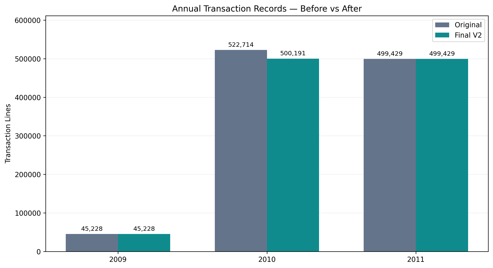
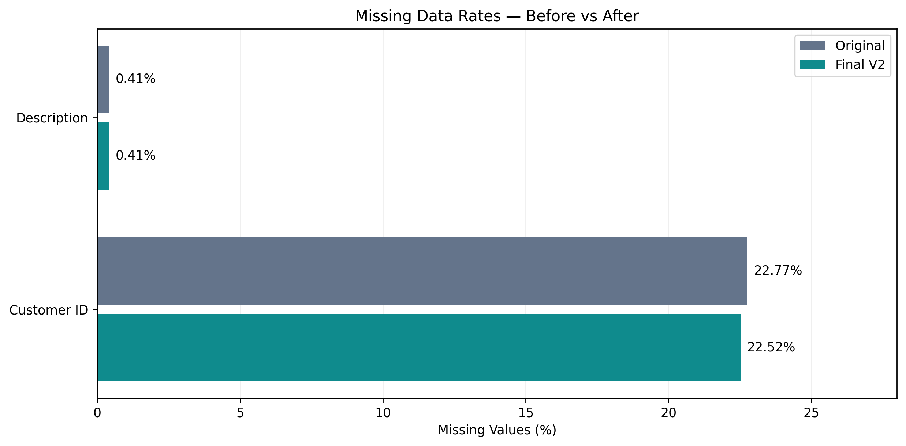
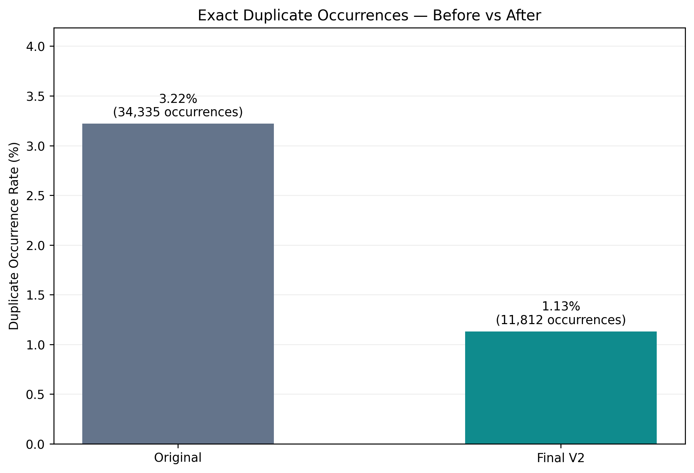
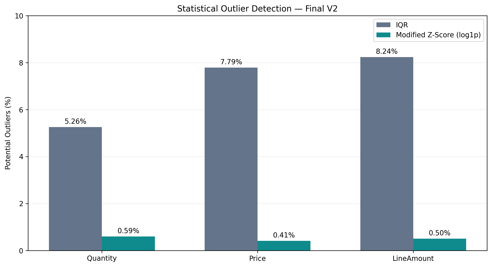
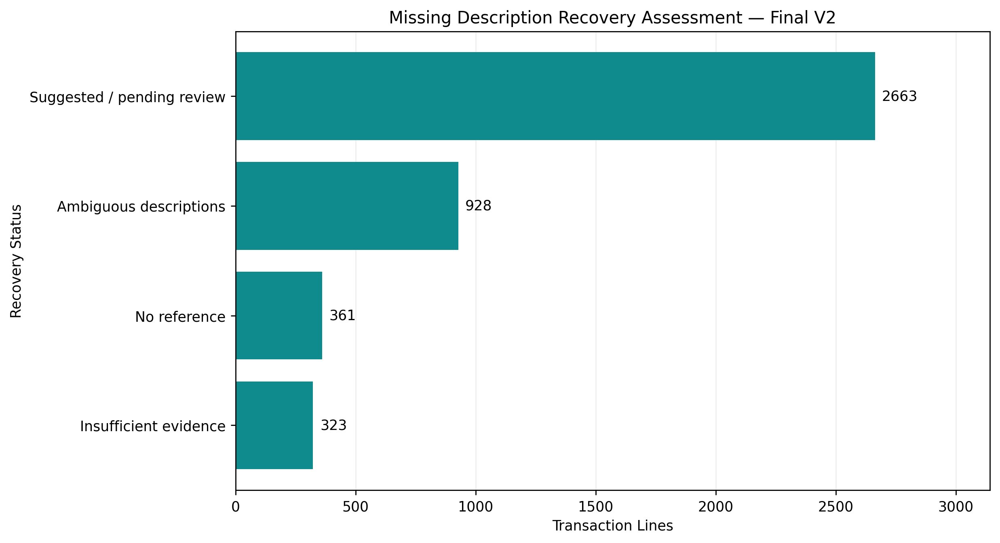
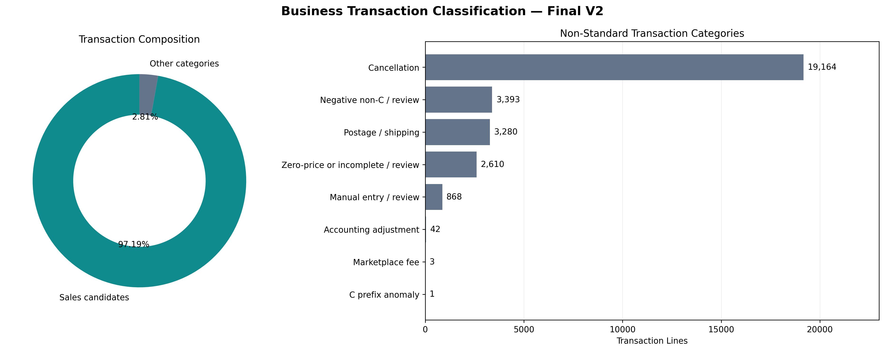
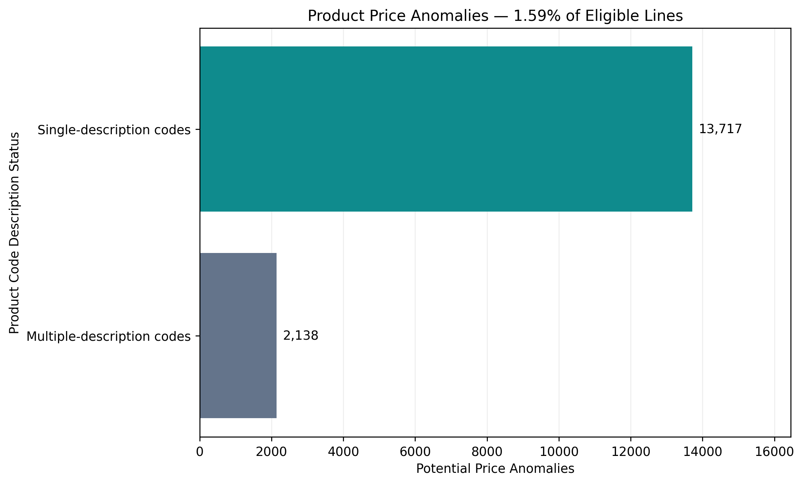

# E-Commerce Data Cleaning & Quality Audit | Python

### Reproducible Transaction Data Pipeline — Online Retail II (2009–2011)

A portfolio project focused on auditing, consolidating, and preparing over one million real-world e-commerce transaction records using Python, Pandas, statistical anomaly detection, and automated testing.

The goal is not simply to delete missing values or outliers. It is to build a traceable and reproducible dataset while preserving business-relevant information.

## Project Highlights

| Metric | Result |
|---|---:|
| Original transaction lines | 1,067,371 |
| Consolidated transaction lines | 1,044,848 |
| Verified overlapping rows excluded | 22,523 |
| Original business columns | 8 |
| Final quality-enriched columns | 34 |
| Exact duplicate occurrences before | 34,335 |
| Exact duplicate occurrences after | 11,812 |
| Description recovery suggestions | 2,663 |
| Potential IQR outliers | 164,870 |
| Potential product-level price anomalies | 15,855 |
| Automated tests | 9 passed |
| Final source-integrity checks | 6 passed |

**Key result:** A reproducible pipeline that resolves verified historical duplication, adds transaction quality indicators, and preserves original business measurements.

## Business Problem

Historical retail exports often contain overlapping reporting periods, missing customer identifiers, repeated transaction lines, cancellations, administrative adjustments, and unusual transaction values.

Naive cleaning approaches can introduce serious analytical errors by:

- Counting the same historical transactions twice.
- Removing legitimate repeated invoice lines.
- Inventing missing customer identifiers.
- Treating accounting adjustments as product sales.
- Deleting legitimate high-volume transactions.

This project addresses these risks through evidence-based validation and non-destructive transformations.

## Dataset

**Source:** UCI Machine Learning Repository — Online Retail II  
**Creator:** Daqing Chen  
**Coverage:** December 2009 to December 2011  
**Source records:** 1,067,371  
**Source format:** Excel workbook with two historical worksheets

Dataset: https://archive.ics.uci.edu/dataset/502/online+retail+ii

The original workbook contains eight business attributes, including invoice identifiers, product codes, descriptions, quantities, invoice dates, prices, customer identifiers, and countries.

The source dataset is licensed under CC BY 4.0. See the attribution section below.

The raw workbook is not committed to this repository. Download it directly from UCI to reproduce the project.

## Methodology

### 1. Data Profiling

Audited the original dataset for missing values, duplicate candidates, transaction exceptions, data types, and temporal coverage.

### 2. Historical Consolidation

Identified an overlapping reporting period between the two worksheets.

Validated complete transaction signatures and their occurrence frequencies before excluding one replicated copy of the shared interval.

**Result:** 22,523 replicated rows excluded while retaining historical coverage and within-worksheet repeated lines.

### 3. Transaction Quality and Classification

Implemented non-destructive quality flags for missing values, cancellations, negative quantities, zero or negative prices, and special operation codes.

Created provisional categories for sales candidates, cancellations, shipping, accounting adjustments, manual entries, and other review cases.

### 4. Missing Data Assessment

Evaluated missing customer identifiers and descriptions.

No customer identifiers could be recovered using a unique known identifier within the same invoice group.

Generated 2,663 auditable description suggestions using product codes with at least five observed descriptions and no normalized description ambiguity.

**Original missing values were preserved.**

### 5. Statistical Outlier Detection

Used two complementary methods:

**Interquartile Range (IQR):**

IQR = Q3 - Q1

Lower bound = Q1 - 1.5 × IQR

Upper bound = Q3 + 1.5 × IQR

**Modified Z-Score:**

Modified Z = 0.6745 × (x - Median) / MAD

The Modified Z-Score was calculated on log1p-transformed positive values, using a threshold of 3.5.

Detection was performed on 1,019,654 eligible transaction lines.

| Variable | IQR alerts | Modified Z-Score alerts |
|---|---:|---:|
| Quantity | 53,630 | 6,055 |
| Price | 79,436 | 4,218 |
| Line amount | 84,005 | 5,124 |

### 6. Product-Level Anomaly Analysis

Compared unit prices with product-level median prices for sufficiently represented stock codes.

Evaluated 1,000,165 eligible lines and flagged 15,855 potential pricing anomalies.

Also identified cases where the same product code is associated with multiple descriptions, requiring careful interpretation.

**All anomaly indicators are investigative flags, not confirmed data errors.**

### 7. Automated Quality Assurance

Implemented nine PyTest tests covering consolidation, validation failures, classification, missing-description recovery, anomaly detection, and end-to-end pipeline execution.

Additionally verified that every retained transaction is traceable to the source and that all eight original business attributes are preserved.

## Before vs. After

| Indicator | Original | Final |
|---|---:|---:|
| Records | 1,067,371 | 1,044,848 |
| Exact duplicate occurrences | 34,335 | 11,812 |
| Duplicate occurrence rate | 3.22% | 1.13% |
| Missing Customer IDs | 243,007 | 235,287 |
| Missing descriptions | 4,382 | 4,275 |
| Working columns | 10 | 34 |

The reduction in missing-value counts comes from excluding replicated records. It does **not** represent automatic imputation.

### Historical Record Comparison



### Missing Data Comparison



### Duplicate Occurrence Comparison



### Statistical Outlier Detection



### Description Recovery Assessment



### Business Transaction Classification



### Product Price Anomalies



## Technical Architecture

Original Excel workbook
  |
  v
Historical consolidation
  |
  v
Transaction classification and DQ flags
  |
  v
Description recovery suggestions
  |
  v
IQR and Modified Z-Score detection
  |
  v
Product-level price anomaly assessment
  |
  v
Quality-enriched Parquet dataset

The workflow is implemented as independent Python modules orchestrated by `src/pipeline.py`.

## Project Structure

- `src/consolidation.py` — Historical worksheet reconciliation
- `src/transformations.py` — Transaction classifications and DQ flags
- `src/description_recovery.py` — Auditable recovery suggestions
- `src/outliers.py` — IQR and Modified Z-Score detection
- `src/product_anomalies.py` — Product-level anomaly assessment
- `src/pipeline.py` — Complete workflow orchestration
- `tests/test_pipeline.py` — Automated unit and integration tests
- `run_pipeline.py` — Command-line entry point
- `figures/` — Visualizations and analytical evidence
- `requirements.txt` — Python dependencies

Source and processed datasets are excluded from version control.

## How to Reproduce

### 1. Clone the repository

Download or clone the project repository.

### 2. Install dependencies

```bash
python -m pip install -r requirements.txt
```

### 3. Download the original dataset

Download `online_retail_II.xlsx` from:

https://archive.ics.uci.edu/dataset/502/online+retail+ii

Place it in:

`data/raw/online_retail_II.xlsx`

### 4. Run the pipeline

```bash
python run_pipeline.py --input data/raw/online_retail_II.xlsx
```

The processed Parquet dataset will be saved in `data/processed/`.

### 5. Run the automated tests

```bash
python -m pytest -v tests/test_pipeline.py
```

The project was developed and validated in Google Colab using Python 3.13 and PyTest.

## Limitations

- Business classifications are provisional and require domain validation.
- Missing customer identifiers are intentionally preserved.
- Description suggestions are not confirmed imputations.
- Internal repeated transaction lines are retained pending business evidence.
- Statistical outlier alerts do not establish data errors.
- Product-level price anomalies may reflect promotions, product variants, or administrative activity.
- This is an independent portfolio project, not an official project commissioned by the original retailer.

## Tools and Skills Demonstrated

Python, Pandas, NumPy, OpenPyXL, PyArrow, Matplotlib, PyTest, Data Cleaning, Data Quality Assessment, Data Reconciliation, Exploratory Data Analysis, Statistical Outlier Detection, and Reproducible Data Pipelines.

## Dataset Attribution

Chen, D. (2012). *Online Retail II* [Dataset]. UCI Machine Learning Repository.

DOI: https://doi.org/10.24432/C5CG6D

Dataset license: Creative Commons Attribution 4.0 International (CC BY 4.0).

## Project Purpose

This independent portfolio project demonstrates the development of reliable, auditable, and reproducible data preparation workflows for real-world business datasets.
